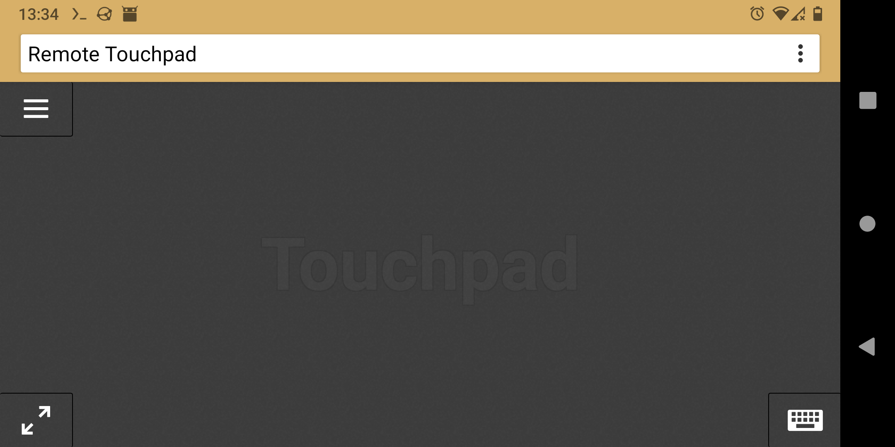
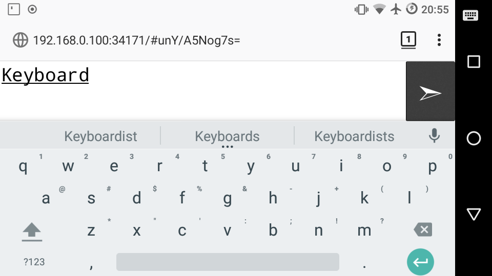
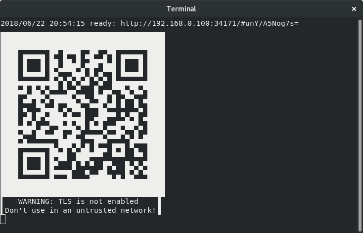
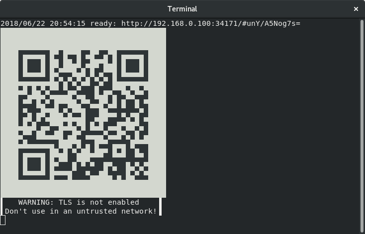

# Remote Touchpad

Control mouse and keyboard from the webbrowser of a smartphone
(or any other device with a touchscreen).
To take control open the displayed URL or scan the QR code.

Supports Flatpak's RemoteDesktop portal (for Wayland), X11, macOS and Windows.

## Installation

* [Flatpak](https://flathub.org/apps/details/com.github.unrud.RemoteTouchpad)
* [Snap](https://snapcraft.io/remote-touchpad)
* [macOS & Windows](https://github.com/Unrud/remote-touchpad/releases/latest)
* Golang:
  * Portal & uinput & X11:

    ```sh
    go install -tags portal,uinput,x11 github.com/unrud/remote-touchpad@latest
    ```
  * Windows:

    ```sh
    go install github.com/unrud/remote-touchpad@latest
    ```

## Gestures

| Gesture | Action |
|---|---|
| 1-finger tap / move | Left click / Move pointer |
| 1-finger tap, then touch and move | Drag |
| 2-finger tap / move | Right click / Scroll |
| 3-finger tap | Middle click |
| 3-finger swipe left / right | Next / Previous workspace |
| 3-finger swipe up / down | Super key (toggle overview) |

Workspaces are switched with `Super+Page_Down` / `Super+Page_Up` on Linux,
`Ctrl+Win+Right` / `Ctrl+Win+Left` on Windows and
`Ctrl+Right` / `Ctrl+Left` on macOS.
On Linux desktops that use different shortcuts, bind `Super+Page_Up` and
`Super+Page_Down` to the desired workspace actions.

## Screenshots








